# Churn & Retention Platform ("Retention Radar")

**Predict which customers will leave, plan the retention campaign with real numbers, and track which offers worked.**

*Topics: Data Preparation · Model Selection · Class Imbalance · Probability Calibration · Risk Tiers · Explainability · Recommendations · Bulk Scoring at 100k · REST API Security · Dashboard*

| Field | Detail |
|---|---|
| **Project** | Churn & Retention Platform (REST API + web dashboard) |
| **Domain** | Telecom customer churn and retention |
| **Dataset** | IBM / Kaggle *Telco Customer Churn* (7,043 real customers) + a 100,000-customer synthetic sample generated from it |
| **Language / Framework** | Python 3.12, Flask 3, SQLAlchemy 2, scikit-learn, XGBoost |
| **Dashboard** | Single-file HTML + vanilla JS + Chart.js (served by the API at `/dashboard`) |
| **Database** | SQLite by default (zero setup); PostgreSQL optional |
| **Tests** | 207 automated tests, 97% coverage, lint clean (black / isort / flake8) |

---

## § 1 · Dataset

**Real data (used to train and judge the model).** The IBM / Kaggle *Telco Customer Churn* file: 7,043 customers x 21 columns, 26.5% of customers churned. It is stored in `data/raw/telco_customer_churn.csv`.

**100,000-customer sample (used to test the platform at scale).** `data/sample/customers_100k.csv` has 100,000 rows x 26 columns (20.6 MB, 26.4% churn). It is **synthetic**: `scripts/generate_dataset.py` re-samples the 7,043 real customers, adds small noise, and adds the fields a real CRM has (name, e-mail, signup date, churn date, about 1% blank values).

> **Important:** the model was trained on the real customers that this sample is made from. **Never use the 100k file to measure accuracy.** Use the held-out numbers in § 5.

| Feature group | Columns |
|---|---|
| Account | `tenure_months`, `monthly_charges`, `total_charges`, `contract_type`, `signup_date`, `is_active`, `churned_at` |
| Services | `internet_service`, `phone_service`, `multiple_lines`, `online_security`, `online_backup`, `device_protection`, `tech_support`, `streaming_tv`, `streaming_movies` |
| Billing | `paperless_billing`, `payment_method` |
| Demographics | `gender`, `senior_citizen`, `partner`, `dependents` |
| Identity | `external_id`, `name`, `email` |

**How the data is used:** 80% train / 20% test (stratified, fixed seed). `TotalCharges` is left out of the model because it is just tenure x monthly charges. Missing values are filled by the model pipeline, exactly as in training.

---

## § 2 · Topics Covered

| # | Topic | What it does (one line) | Where |
|---|---|---|---|
| 1 | **Data preparation** | Cleans types, fills missing values, scales numbers and encodes categories in one scikit-learn pipeline. | `app/ml/pipeline.py` |
| 2 | **Model selection** | Trains Logistic Regression, Random Forest and XGBoost with 5-fold CV and picks the winner on churn recall and F1, not accuracy. | `app/ml/train.py` |
| 3 | **Class imbalance** | Uses class weights because only about 1 in 4 customers churns. | `app/ml/train.py` |
| 4 | **Probability calibration** | Re-maps raw scores (Platt scaling) so "60%" really means about 60% of such customers leave. | `app/ml/calibration.py` |
| 5 | **Risk tiers** | Low below 25%, Medium below 50%, High from 50% (on calibrated probability). | `app/ml/predict.py` |
| 6 | **Explainability** | Shows the top reasons behind each score (coefficient x value) so a person can act on it. | `app/ml/predict.py` |
| 7 | **Recommendations** | Maps the top risk factor to a suggested offer using a small rules table. | `app/ml/predict.py` |
| 8 | **Bulk scoring at 100k** | Scores whole chunks at once (about 20,000 rows in 0.5 s) and imports a 100k CSV in about 30 s. | `predict_frame`, `import_service.py` |
| 9 | **Campaign ROI** | Picks only customers where expected revenue saved is higher than the offer cost; shows cost, ROI and a lift curve. | `insights_service.py` |
| 10 | **Outcome tracking** | Records whether each retention action kept or lost the customer. | `action_service.py` |
| 11 | **REST API & security** | JWT login with refresh and logout, admin / analyst roles, rate limits, CSP headers, one error format. | `app/api/`, `app/utils/` |
| 12 | **Dashboard** | Nine pages: command center, customers, explorer, campaign planner, action board, simulator, import, model quality, admin. | `dashboard/index.html` |

---

## § 3 · Project Structure

```
churn-retention-api/
├── app/
│   ├── api/            # routes (auth, customers, predictions, analytics, actions, imports, exports, admin, model)
│   ├── services/       # business logic (analytics, insights, imports, predictions, ...)
│   ├── repositories/   # all database queries
│   ├── models/         # SQLAlchemy tables
│   ├── schemas/        # request / response validation (also feeds the /docs page)
│   ├── ml/             # pipeline, training, calibration, prediction, saved model (artifacts/)
│   └── utils/          # errors, auth decorators, cache, logging
├── dashboard/index.html        # the whole web app (one file)
├── data/
│   ├── raw/telco_customer_churn.csv        # real dataset (7,043 rows)
│   └── sample/customers_100k.csv           # synthetic 100,000-row sample
├── migrations/                 # Alembic (only needed for PostgreSQL)
├── scripts/generate_dataset.py # makes the 100k sample
├── screenshots/                # images used in this README
├── tests/                      # unit + integration tests
├── requirements.txt            # run-time packages
├── requirements-dev.txt        # test + code-style packages
├── .env.example                # optional settings
└── wsgi.py                     # entry point
```

The code follows one rule: **routes → services → repositories → models.** Routes only handle HTTP, services hold the logic, repositories hold the queries.

---

## § 4 · Dashboard Screenshots

Sign in at `http://127.0.0.1:5000/dashboard` (all screenshots below use the 100,000-customer sample).

**Sign in**

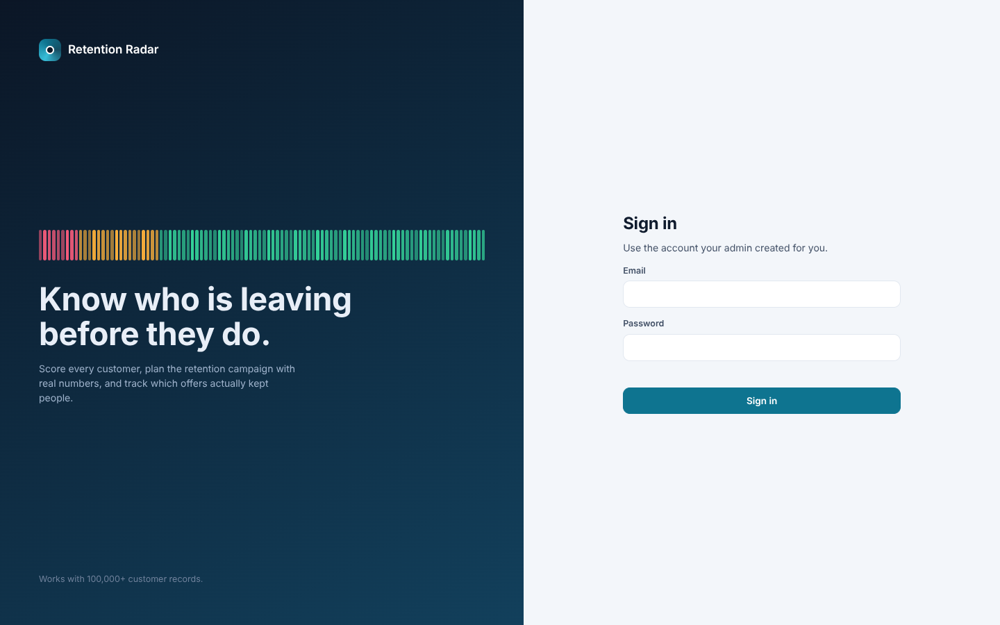
*Figure 1 · Sign-in page. Accounts are created by an admin, nothing is pre-filled.*

**Command center**

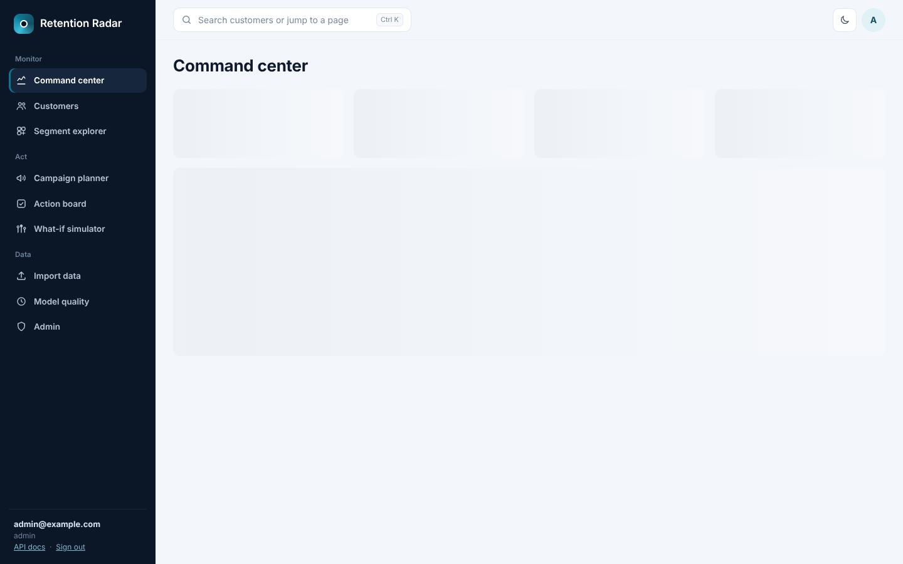
*Figure 2 · Monthly revenue at risk, a 100-block risk bar of all active customers (1 block = 1%), weekly churn trend and the "who to call first" list.*

**Customers**

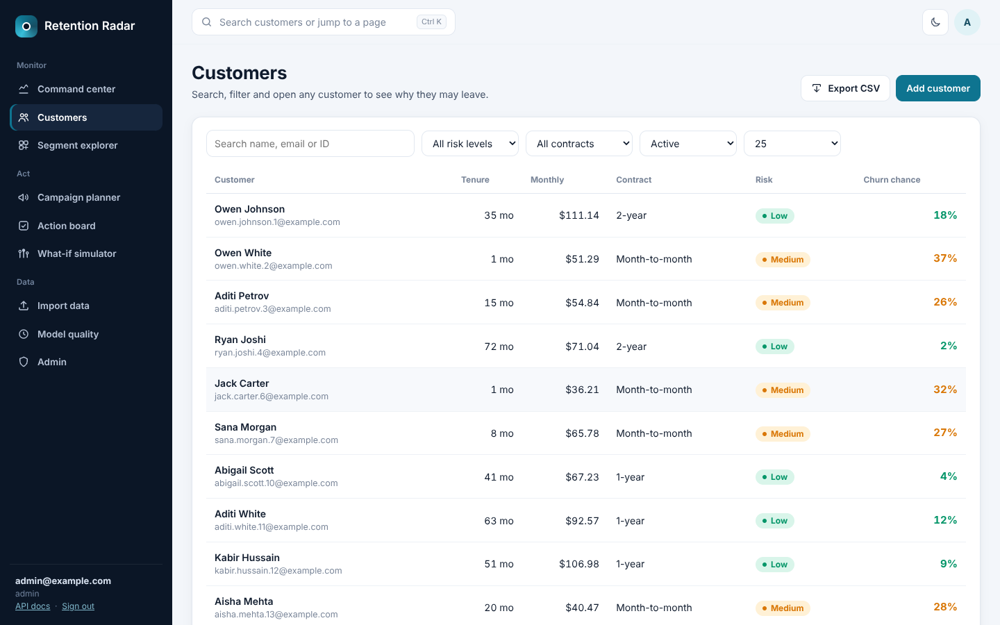
*Figure 3 · Search, filter and sort across about 73,600 active customers with page controls and CSV export.*

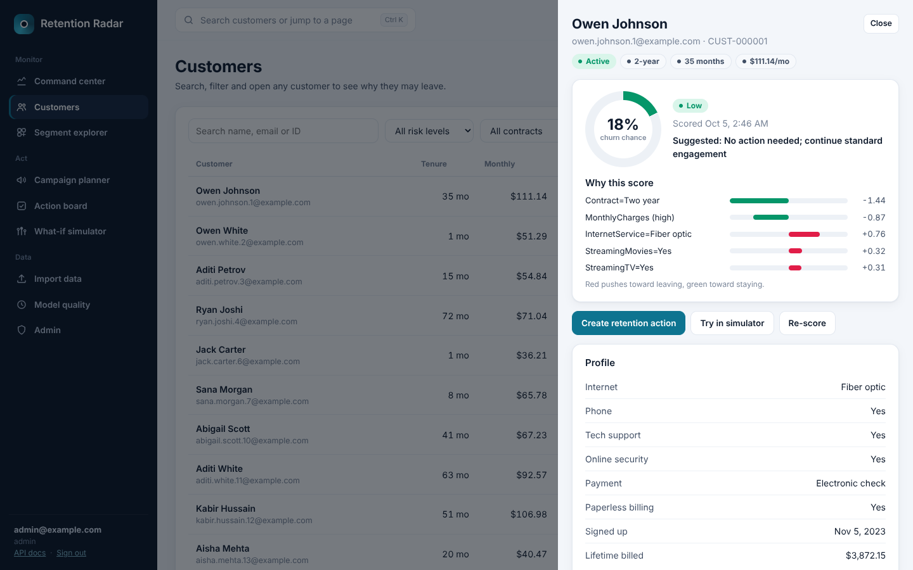
*Figure 4 · Customer detail: churn chance gauge, the reasons behind the score (red pushes toward leaving, green toward staying), profile and actions.*

**Segment explorer**

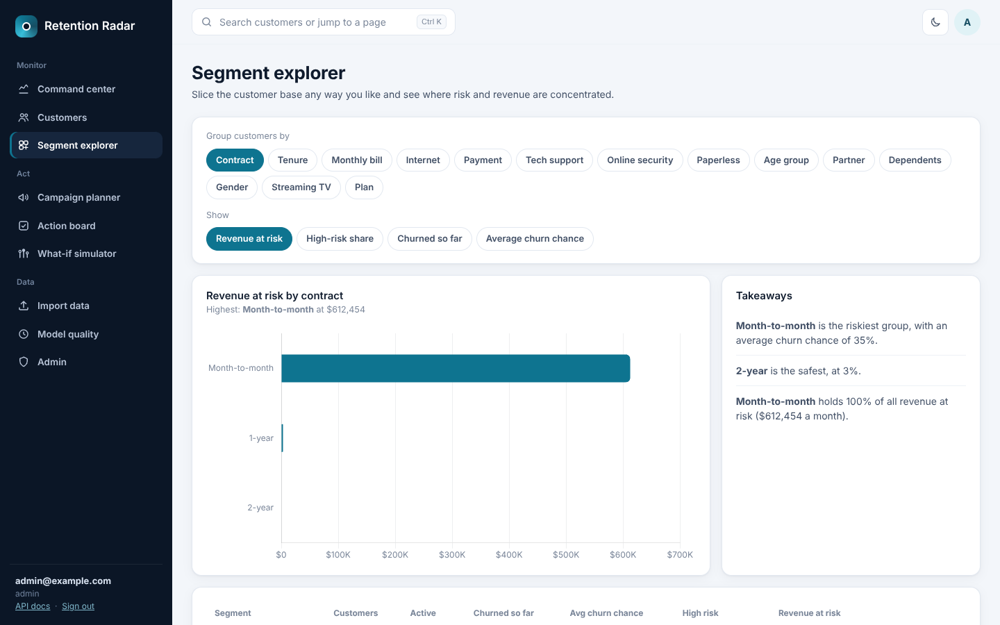
*Figure 5 · Group customers by contract, tenure, bill, add-ons and more to see where revenue at risk is concentrated.*

**Campaign planner**

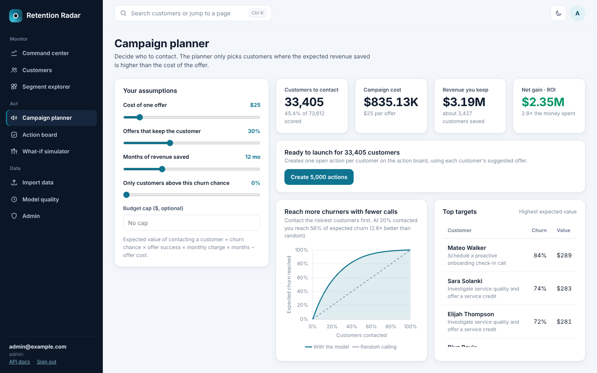
*Figure 6 · Set offer cost, success rate, months and budget; the planner shows who to contact, total cost, net gain, ROI and the lift curve.*

**What-if simulator**

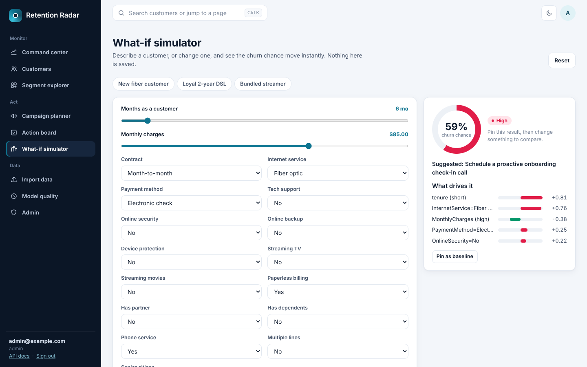
*Figure 7 · Change a customer's contract, price or add-ons and watch the churn chance and its drivers move. Nothing is saved.*

**Action board**

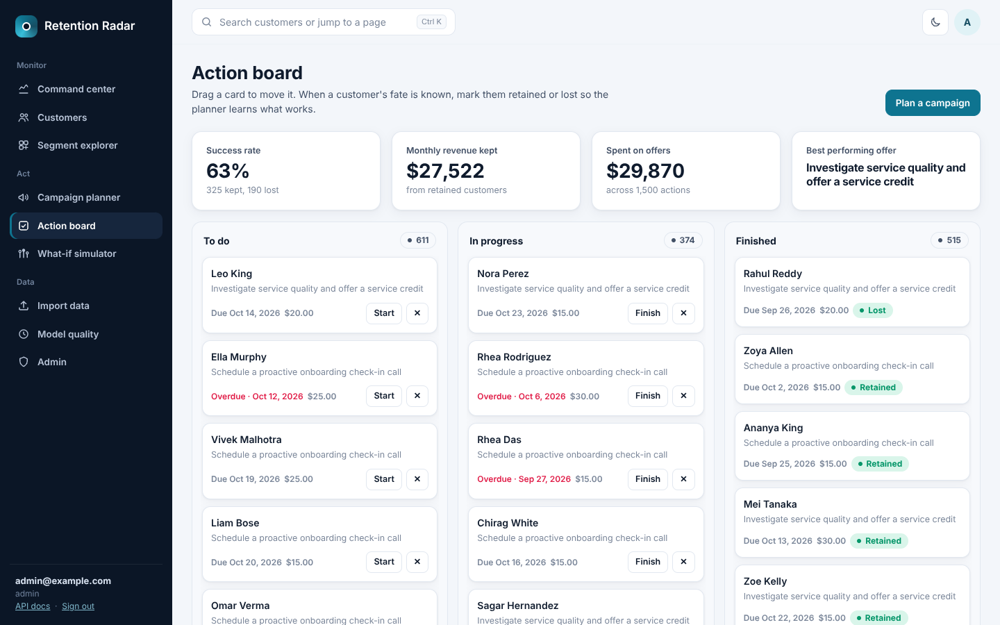
*Figure 8 · Drag-and-drop board (to do / in progress / finished) with due dates and Kept / Lost outcomes. The top cards show the real success rate.*

**Import data**

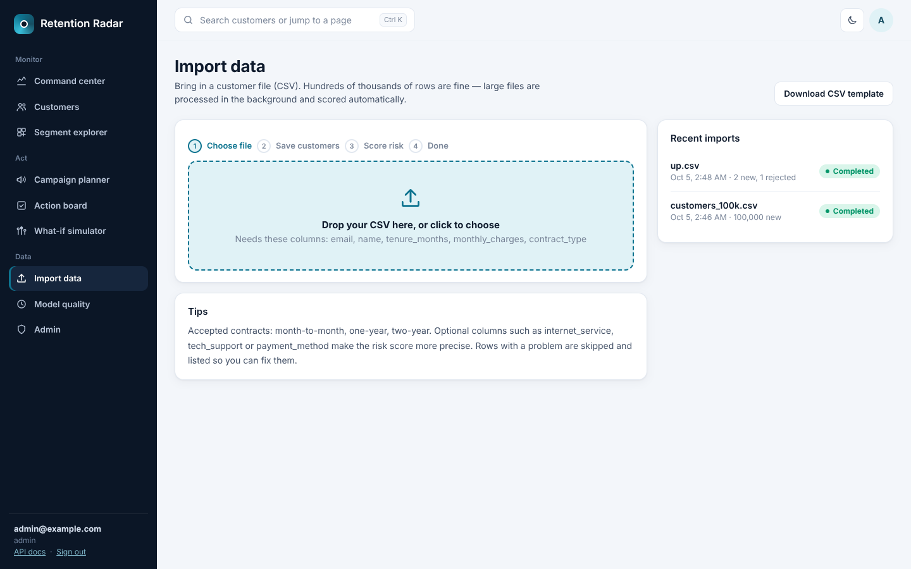
*Figure 9 · Drag-and-drop CSV import with live progress, a row-by-row error report and a downloadable template.*

**Model quality**

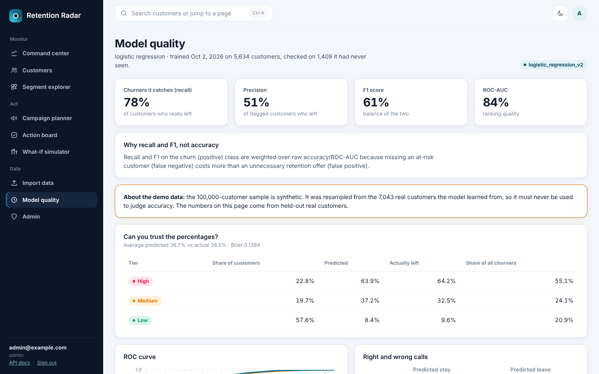
*Figure 10 · Held-out recall, precision, F1 and ROC-AUC, calibration table, ROC curves and confusion matrix.*

**Dark mode**

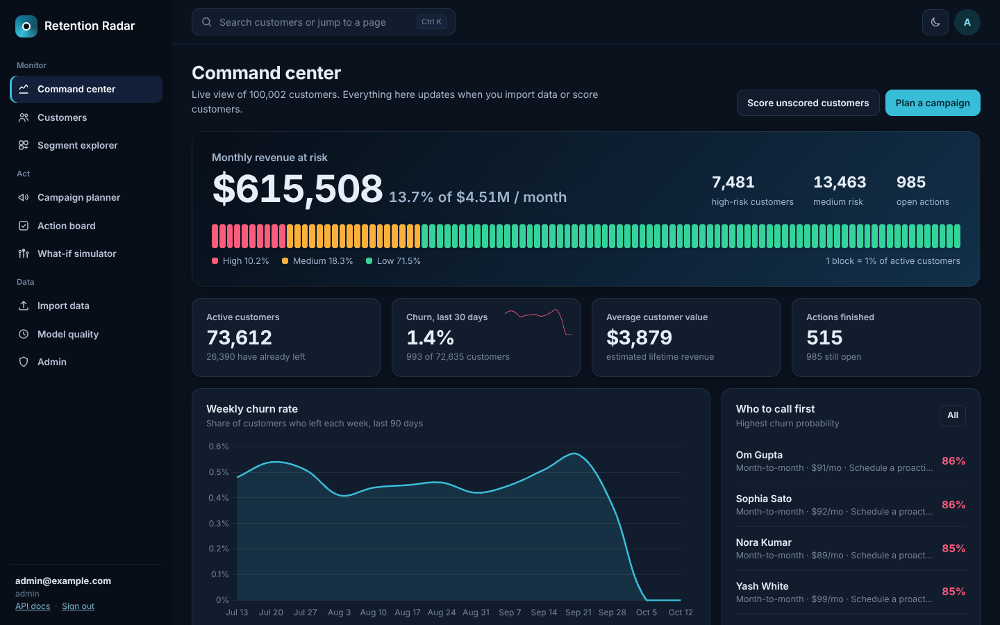
*Figure 11 · Same command center in dark mode (switch with the moon button). Ctrl + K opens search from any page.*

---

## § 5 · Results

All model numbers come from the **1,409 held-out customers** the model never saw (5,634 train / 1,409 test). The model was chosen for churn **recall and F1**, because missing a customer who will leave costs more than one extra offer.

### 5a · Model comparison (held-out test set)

| Model | Accuracy | Precision | Recall | F1 | ROC-AUC |
|---|---|---|---|---|---|
| **Logistic Regression (selected)** | 74.0% | 50.7% | **77.5%** | **61.3%** | **83.8%** |
| Random Forest | 77.4% | 56.7% | 62.3% | 59.4% | 82.7% |
| XGBoost | 74.7% | 51.7% | 71.9% | 60.2% | 82.6% |

Confusion matrix of the selected model: 753 stayed and predicted stay, 282 stayed but flagged, 84 churners missed, 290 churners caught.

### 5b · Are the probabilities honest? (calibrated, held-out)

Average predicted churn 26.7% vs actual 26.5% (Brier score 0.139, down from 0.169 before calibration).

| Risk tier | Share of customers | Predicted churn | Actually churned | Share of all churners |
|---|---|---|---|---|
| High (50%+) | 22.8% | 63.9% | 64.2% | 55.1% |
| Medium (25–50%) | 19.7% | 37.2% | 32.5% | 24.1% |
| Low (below 25%) | 57.6% | 8.4% | 9.6% | 20.9% |

### 5c · Scale test (100,000-customer synthetic sample, SQLite, one laptop-class machine)

| Task | Result |
|---|---|
| Import 100,000 customers and score 73,610 active ones | about 29 seconds |
| Score 20,000 rows (vectorised) | 0.5 seconds |
| Every analytics endpoint (overview, segments, trends, risk, campaign, explorer) | under 1 second |
| Customers with risk **High / Medium / Low** (active) | 10.2% / 18.3% / 71.5% |
| Monthly revenue at risk | about $615,000 of $4.51M (13.7%) |

These scale numbers show speed and the dashboard, not model accuracy (see the note in § 1).

### 5d · Business insight

- **Month-to-month contracts hold essentially all the risk:** 23% of active month-to-month customers are High risk, against under 1% on one- and two-year contracts.
- **Best first move:** offer month-to-month customers a 12-month contract discount, starting with the highest expected value (churn chance x monthly charge).
- **Do not trust the explanations as causes.** They show what the model leaned on, which is a good prompt for a conversation, not proof of why someone leaves.

---

## § 6 · Quick Start

Requires Python 3.12 (3.10+ works). No database or Redis needed.

```bash
# 1. install
python -m venv venv
source venv/bin/activate            # Windows: venv\Scripts\activate
pip install -r requirements.txt
cp .env.example .env                # Windows: copy .env.example .env

# 2. create the database, the model check and an admin user
python -m flask --app wsgi init-db
python -m app.ml.ensure_model       # uses the bundled model; retrains only if it is missing
python -m flask --app wsgi create-admin --email admin@example.com --password 'Admin@12345'

# 3. load the 100,000 customers (about 30 s) and, optionally, demo actions
python -m flask --app wsgi import-csv data/sample/customers_100k.csv
python -m flask --app wsgi seed-actions

# 4. run
python -m flask --app wsgi run      # open http://127.0.0.1:5000/dashboard
```

Sign in with `admin@example.com` / `Admin@12345` (change this password for any real use).

Other commands:

| Command | Purpose |
|---|---|
| `python -m flask --app wsgi seed-demo --count 300` | Small demo set from the real Telco file (with billing history) |
| `python -m flask --app wsgi train` | Retrain and compare the three models |
| `python scripts/generate_dataset.py --rows 100000` | Rebuild the 100k sample (any size, `--as-of YYYY-MM-DD`, `--seed N`) |
| `http://127.0.0.1:5000/docs` | Interactive API documentation (Swagger) |

**Optional settings** live in `.env` (see `.env.example`): `DATABASE_URL` for PostgreSQL (then run `flask db upgrade` instead of `init-db`), `REDIS_URL` for shared caching, token lifetimes, rate limits and the risk thresholds. In production (`FLASK_ENV=production`) the app refuses to start unless `SECRET_KEY` and `JWT_SECRET_KEY` are long random values.

---

## § 7 · API Summary

All endpoints return JSON; every error uses `{"error": {"code", "message", "details"}}`. Full details are on `/docs`.

| Area | Endpoints | Who |
|---|---|---|
| Auth | `POST /auth/login`, `/auth/refresh`, `/auth/logout`, `GET /auth/me`, `POST /auth/register` (admin) | everyone / admin |
| Customers | `GET/POST /customers`, `GET/PUT/DELETE /customers/<id>`, `GET/POST /customers/<id>/transactions` | analyst, admin (delete: admin) |
| Predictions | `POST /predict` (stored customer or raw features), `POST /predict/batch`, `GET /predictions` | analyst, admin |
| Analytics | `GET /analytics/overview`, `/segments`, `/trends`, `/risk-distribution`, `/revenue-at-risk`, `/high-risk`, `/campaign`, `/explorer`, `/outcomes` | analyst, admin |
| Actions | `GET/POST /actions`, `POST /actions/bulk`, `GET/PUT/DELETE /actions/<id>` | analyst, admin (delete: admin) |
| Import | `POST /imports` (CSV), `GET /imports`, `GET /imports/<id>`, `GET /imports/template.csv` | upload: admin |
| Export | `GET /export/customers.csv`, `/export/predictions.csv`, `/export/high-risk.csv` | analyst, admin |
| Model / Admin | `GET /model/info`, `/admin/users`, `/admin/logs`, `/admin/activity`, `GET /health` | analyst, admin |

**CSV import columns:** required `email, name, tenure_months, monthly_charges, contract_type` (`month-to-month`, `one-year`, `two-year`). Optional: `external_id, signup_date, total_charges, plan, is_active, churned_at` and the service columns (`internet_service`, `tech_support`, `payment_method`, ...). Download the template from the dashboard or `GET /imports/template.csv`.

---

## § 8 · Testing

```bash
pip install -r requirements-dev.txt
python -m pytest --cov=app --cov-report=term-missing          # in-memory SQLite
black --check --line-length 120 app tests scripts && flake8 app tests scripts
```

**207 tests, 97% coverage.** They cover the ML pipeline and training, single and vectorised scoring (checked row by row to give identical results), every API endpoint (success, validation errors, permissions), the CSV import (good, bad and duplicate rows, skip vs update), campaign and explorer math, bulk actions, the CLI and rate limiting. A tiny model is built inside the tests, so they do not depend on the trained one.

---

## § 9 · Video

> **Video link:** *(paste your recording link here, e.g. `https://drive.google.com/...`)*

---

## § 10 · Tools Used & Requirements

| Purpose | Tools |
|---|---|
| Web API | Flask 3, flask-smorest (OpenAPI / Swagger), marshmallow |
| Database | SQLAlchemy 2, Flask-SQLAlchemy, Alembic / Flask-Migrate, SQLite (default) or PostgreSQL |
| Security | Flask-JWT-Extended, bcrypt, Flask-Limiter, Flask-Talisman, Flask-Cors |
| Caching | Flask-Caching (in-process, or Redis if `REDIS_URL` is set) |
| Machine learning | scikit-learn, XGBoost, SHAP, pandas, numpy, joblib |
| Dashboard | HTML, vanilla JavaScript, Chart.js (CDN), Google Fonts (Manrope, Sora) |
| Testing & style | pytest, pytest-cov, black, isort, flake8 |

All Python packages with pinned versions are listed in `requirements.txt` (run-time) and `requirements-dev.txt` (tests and code style).

---

## § 11 · Known Limitations

- **The 100k file is synthetic.** It is for speed and demo only; judge the model on the held-out numbers in § 5.
- **Explanations are conditional, not causal.** Use them as hints for a conversation.
- **The real dataset is a one-time snapshot.** It has no dates, so real trend forecasting or drift detection is not possible with it. The weekly trend chart uses the dates in the synthetic sample.
- **Campaign success rate is your assumption** until enough Kept / Lost outcomes are recorded on the action board.
- **Fairness:** `gender` and `SeniorCitizen` are model inputs. Check that offers driven by them are acceptable where you operate.
- **Retraining is manual** (`flask train`). There is no scheduled retraining or drift alert.
- **PostgreSQL** is supported but the newest migration was not run against a live PostgreSQL server in this build.

---

## § 12 · Final Checklist

- [x] Real Telco dataset in `data/raw` and a 100,000-row sample in `data/sample` (clearly labelled synthetic)
- [x] Preprocessing pipeline with scaling, encoding and missing-value handling
- [x] Three models compared with cross-validation; winner chosen on recall and F1
- [x] Probabilities calibrated; risk tiers checked against actual churn
- [x] Per-customer explanations and recommended action
- [x] Vectorised scoring and 100k CSV import with progress and error report
- [x] Campaign ROI planner, segment explorer, what-if simulator, outcome tracking
- [x] JWT login, roles, rate limits, security headers, one error format
- [x] Nine-page dashboard with light / dark mode, mobile layout and Ctrl + K search
- [x] 207 tests passing, 97% coverage, lint clean
- [x] Screenshots with captions, results tables, tools and requirements listed
- [ ] Video link pasted in § 9
